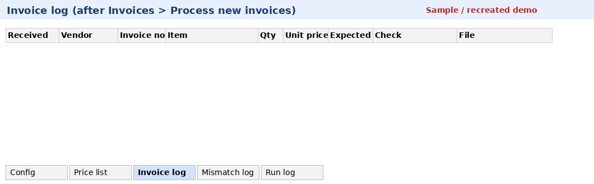
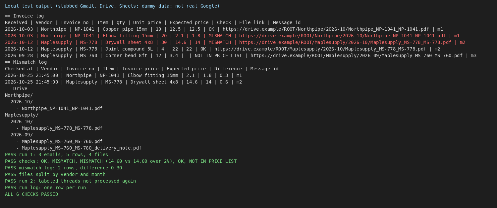

# Gmail invoice filing (Google Apps Script)

For bookkeepers or office managers who log supplier invoices and check line prices by hand.

Turns hand-logging supplier invoices and price checks into one scheduled script run.




The GIF is a recreated spreadsheet layout (banner: Sample / recreated demo), not a screenshot of a signed-in Google account. The PNG is local mock test output with stubbed Gmail, Drive, and Sheets and dummy suppliers; it is not a real Google account screen.

All names, emails, and files in the repo are dummy data. This project was verified only with `node tests/local_check.js`, not on a live Google account.

## What it does

1. Searches Gmail with the query in the Config tab (for example `label:invoices has:attachment`) and skips threads that already have the "processed" label.
2. Reads each email: vendor (from the sender domain), invoice number, and item lines in the form `Item: ... | Qty: ... | Unit price: ...`.
3. Saves each attachment to `Root folder / Vendor / YYYY-MM` in Drive, creating folders when needed.
4. Writes one row per item to the **Invoice log** tab, with a link to the filed attachment.
5. Compares each unit price with the **Price list** tab. The result is `OK`, `MISMATCH` (outside the tolerance in Config) or `NOT IN PRICE LIST`. Mismatches are also written to the **Mismatch log** tab with the difference.
6. Labels the thread so it is not processed twice, and writes a summary row to the **Run log** tab.

## Setup

1. Create a Google Sheet with two tabs: `Config` and `Price list`. Copy the contents of `sample_data/config.csv` and `sample_data/price_list.csv`.
2. In Config, set `drive_root_folder_id` to the ID of the Drive folder for invoices, and adjust `search_query`, `processed_label`, `tolerance_pct` and `max_threads_per_run`.
3. Open Extensions > Apps Script, paste `src/Code.gs`, and replace the manifest with `src/appsscript.json`.
4. Reload the Sheet and use the menu **Invoices > Process new invoices**, or add a time-driven trigger for `processInvoices`.

## Scopes

- `gmail.modify`: read invoice emails and add the processed label.
- `drive`: create vendor and month folders inside a folder you already have. `drive.file` cannot write into existing folders; if you prefer a new dedicated folder created by the script, this can be narrowed to `drive.file`.
- `spreadsheets.currentonly`: write to the Sheet the script is bound to.

## Limits

- Item lines are read with a simple text pattern. Real invoices often put prices only inside the PDF; reading PDF contents (for example through OCR or a vendor-specific format) is not included here.
- The vendor name comes from the sender domain. A vendor-to-sender mapping tab would be the next step for vendors that send from shared mail services.
- Apps Script quotas apply (run time, Gmail read limits). `max_threads_per_run` keeps each run small.
- Processed emails are tracked by label and by message ID in the log.

## Local test

```
node tests/local_check.js
```

The script loads `src/Code.gs` with stubbed GmailApp, DriveApp, and SpreadsheetApp and the three dummy emails in `sample_data/emails.json`. When it passes, the console reports:

- Run 1: 3 emails, 5 invoice log rows, 4 Drive files
- Row checks: OK, MISMATCH, MISMATCH (14.60 vs 14.00 over 2%), OK, NOT IN PRICE LIST
- Mismatch log: 2 rows; first listed difference 0.30
- Run 2: labeled threads are not processed again
- Run log: one summary row per run
- Six assertions passed (same totals as `demo/local_check_output.txt`)

## License

MIT
